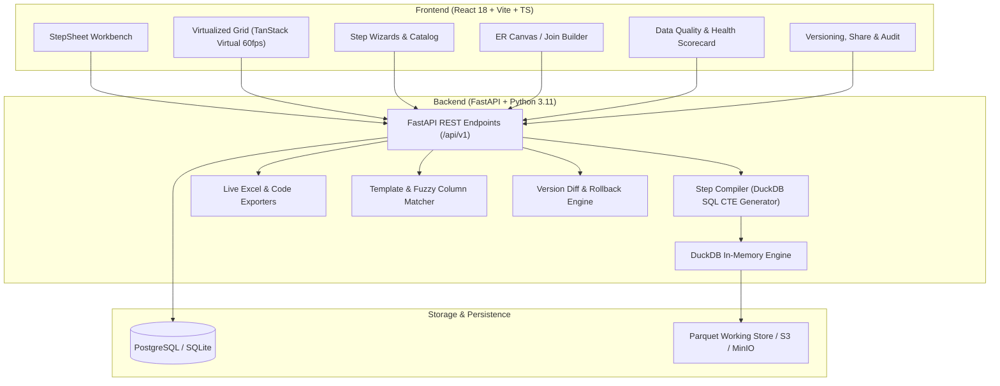

# StepSheet 📊

> **No-Code Data Workbench for Analysts:** Build Excel-style formulas and analytical transformations entirely through guided UI steps. 100% Open Source (MIT), self-hostable, zero proprietary cloud lock-in.

[](LICENSE)
[](https://www.python.org/)
[](https://fastapi.tiangolo.com/)
[](https://duckdb.org/)
[](https://react.dev/)

---

## 🎯 What is StepSheet?
Data analysts upload Excel (`.xlsx`), CSV, and Parquet files and apply transformations, lookups, and formulas through **guided visual steps**—without needing to memorize complex Excel formula syntax (`XLOOKUP`, `INDEX-MATCH`, `SUMIFS`, nested `IF`) or Power Query M.

Every transformation is recorded as a typed, re-runnable **Step** (like Power Query "Applied Steps"). When done, you can export the output and logic to:
- **Real Excel spreadsheets with live formulas** (e.g. `XLOOKUP`, `SUMIFS`, `IF`, `=B2 - C2`) and an audit trail documentation sheet
- **Power Query M scripts**
- **DuckDB / ANSI SQL queries**
- **Python (Polars) scripts**
- **JSON Pipeline files** for re-running on new files
- **Reusable Templates with Column Mapping** to instantiate across datasets

---

## 🏗 Architecture Diagram



---

## ⚡ Complete Feature Matrix

| Category | Features |
| :--- | :--- |
| **Data Engine & File I/O** | DuckDB in-process execution, streaming Parquet working files, Excel `.xlsx` / CSV / Parquet upload, virtualized 60fps windowing over 1M+ rows. |
| **Lookups & Joins** | VLOOKUP, HLOOKUP, XLOOKUP, INDEX-MATCH, Append (Union All & By-Name), 10 Join types (Inner, Left, Right, Full, Semi, Anti, Cross, Self, Range, Fuzzy), Pre-Join Health Check, Cardinality Verdict, Unmatched rows download, Multi-Table ER Canvas. |
| **Logic & Formulas** | Visual IF / IFS / SWITCH builder, IFERROR, ISBLANK, Math transforms (`+`, `-`, `*`, `/`, `ROUND`, `ABS`, `MOD`, `PERCENT_CHANGE`, `BIN`), Date & Time math (`YEAR`, `MONTH`, `QUARTER`, `DATEDIF`, `EOMONTH`), Text cleansing (`TRIM`, `PROPER`, `LOWER`, `UPPER`, `SPLIT`, `CONCAT`, `REGEX`). |
| **Aggregations & Reshaping** | Group By with multi-aggregations (`SUM`, `COUNT`, `AVG`, `MIN`, `MAX`, `DISTINCT_COUNT`), Window calculations Over Time / Within Group (Running Total, Rank, Row Number, Moving Avg), Pivot & Unpivot. |
| **Data Quality & Integrity** | Rule builder (`not_null`, `unique`, `range`, `allowed_values`, `regex`), Quick Audit battery, Health Score (0-100%), Failing rows CSV export. |
| **Multi-Format Exporters** | Live `.xlsx` formulas (re-calculated in Excel/Calc), audit documentation sheet, CSV, Parquet, JSON, standalone Power Query M, SQL, Polars Python scripts, full dataset background execution. |
| **Reusability & Collaboration** | Reusable templates catalog, Fuzzy column mapping auto-suggest, Project version milestones (v1, v2...), Step Diff visual comparison, Role-based sharing links (`viewer`, `editor`), Immutable Audit Trail. |
| **Plain English Assistant** | Natural language to step wizard pre-fill with heuristic rule-based engine and pluggable Ollama / OpenAI adapter; review & approve requirement. |

---

## 🛠 Developer Guide: How to Add a New Step Type

StepSheet is built so adding a new transformation step takes only 5 simple, modular components:

### 1. Define the Pydantic Schema
In `apps/api/app/schemas/steps.py`, register the step type in `StepType` enum and create its parameters model:
```python
class MyCustomStepParams(BaseModel):
    column: str
    factor: float = 1.0
    output_column: Optional[str] = None
```

### 2. Implement the DuckDB Compiler Logic
In `apps/api/app/services/step_compiler.py`, handle the step type in `compile_pipeline()`:
```python
elif stype == "my_custom_step":
    col = params["column"]
    factor = params.get("factor", 1.0)
    out_col = params.get("output_column") or f"{col}_scaled"
    
    expr = f'CAST("{col}" AS DOUBLE) * {factor}'
    proj = [f'{prev_cte}."{c}"' for c in current_cols] + [f'{expr} AS "{out_col}"']
    current_cols.append(out_col)
    
    cte_sql = f"{curr_cte} AS (SELECT {', '.join(proj)} FROM {prev_cte})"
    ctes.append(cte_sql)
    
    generated.sql = f'SELECT {col} * {factor} AS {out_col}'
    generated.polars = f'df = df.with_columns(({factor} * pl.col("{col}")).alias("{out_col}"))'
    generated.power_query_m = f'Table.AddColumn(Source, "{out_col}", each [#{col}] * {factor})'
```

### 3. Add Live Excel Formula Exporter Rule
In `apps/api/app/services/export_service.py`, map the step to real Excel formula syntax:
```python
elif stype == "my_custom_step":
    c_letter = col_letters.get(params["column"], "A")
    factor = params.get("factor", 1.0)
    formula_map[params["output_column"]] = f"={c_letter}{{row}} * {factor}"
```

### 4. Create the Frontend Step Modal Form
In `apps/web/src/components/transforms/`, create the React Hook Form dialog:
```tsx
export const MyCustomStepModal = ({ isOpen, onClose }) => {
  const { addStep, columns } = useWorkbenchStore();
  // Render column picker dropdown, factor number input, and "Show formula" toggle
  // On submit: addStep({ id: uuid(), type: 'my_custom_step', params: { ... }, label: '...' })
};
```

### 5. Add Golden-File Unit Test
In `apps/api/tests/`, add the verification test:
```python
def test_my_custom_step(client):
    csv = "amt\n100\n200\n"
    ds_id = upload_test_csv(client, csv, "custom.csv")
    res = client.post("/api/v1/pipelines/preview", json={
        "dataset_id": ds_id,
        "steps": [{"id": "s1", "type": "my_custom_step", "params": {"column": "amt", "factor": 1.5, "output_column": "amt_scaled"}}],
    })
    assert res.json()["rows"][0]["amt_scaled"] == 150.0
```

---

## 🚀 Quick Start (Local Development)

### 1. Prerequisites
- Python 3.11+
- Node.js 18+ (Node 20+ recommended)

### 2. Backend Setup
```bash
# In repo root:
python -m venv .venv
# Activate:
# Windows: .\.venv\Scripts\Activate.ps1
# Mac/Linux: source .venv/bin/activate

pip install -r apps/api/requirements.txt
cd apps/api
uvicorn app.main:app --reload --port 8000
```
Interactive OpenAPI documentation will be live at `http://127.0.0.1:8000/docs`.

### 3. Frontend Setup
```bash
cd apps/web
npm install
npm run dev
```
Open `http://localhost:5173` to launch the StepSheet Workbench!

### 4. Docker Deployment
```bash
docker compose -f docker/docker-compose.yml up --build
```

---

## 🧪 Testing

### Backend Unit & Integration Tests (61 Tests)
```bash
pytest apps/api/tests -v
```

### Frontend Tests (13 Vitest Tests)
```bash
cd apps/web
npm test -- --run
```

---

## 🔒 Security & Non-Functional Requirements
- **No Macro/Formula Injection**: All uploaded spreadsheets treat cells strictly as raw data; formulas are never evaluated during file read.
- **SQL Sanitization**: All DuckDB queries are constructed using validated Pydantic schemas with strictly quoted column identifiers.
- **Request Tracing**: `X-Request-ID` headers are injected and propagated through every HTTP request.
- **Audit Logging**: All pipeline actions, exports, and template applications are recorded into immutable database audit logs.

---

## 📄 License
MIT License. StepSheet is 100% open source and free for commercial and personal use.
