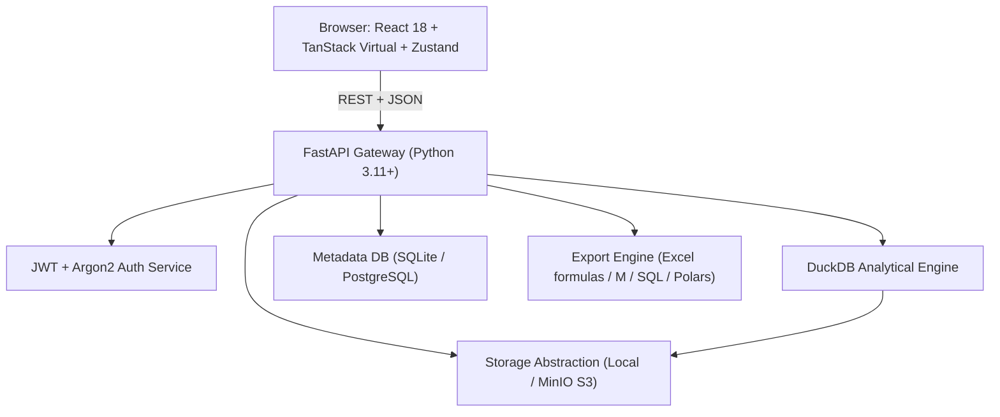

# StepSheet Architecture & Technical Specification

## System Overview

## Core Principles

1. **Client Never Loads 1M Rows**: The virtualized grid requests paginated row windows (`limit=100`, `offset=...`) with sorting/filtering pushed down to DuckDB.
2. **Deterministic Step Pipeline**: Every transformation is a typed JSON step. Step execution is reproducible and can be compiled into DuckDB SQL, Excel formulas, Power Query M, and Python Polars code.
3. **Reactive Preview Sample**: For responsive step editing, preview runs on a sampled window (e.g. 200–1000 rows) in under 100ms. "Run Full" executes across the complete dataset.
4. **Storage Abstraction**: Files are saved with unique IDs and converted to Parquet on ingestion for high-speed DuckDB querying.

## Dataset Registry & Lifecycle

1. User uploads CSV / XLSX.
2. Backend validates size and MIME type.
3. Ingestion converts raw file to canonical Parquet format in storage.
4. Schema (column names, inferred DuckDB types, row count, byte size) is registered in the database.
5. Column profiler computes null counts, distinct values, min/max, top frequencies, and histograms.
